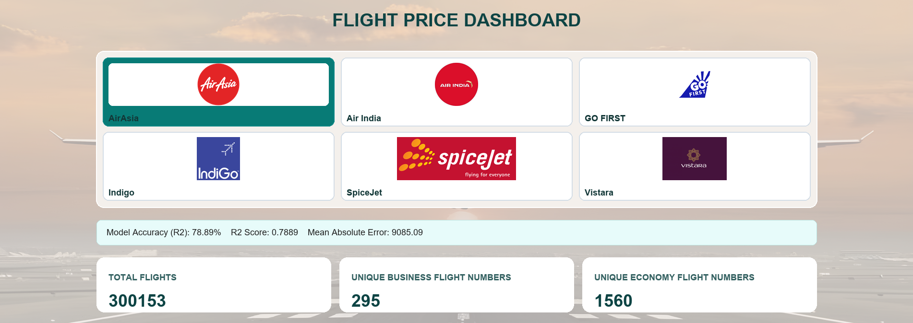
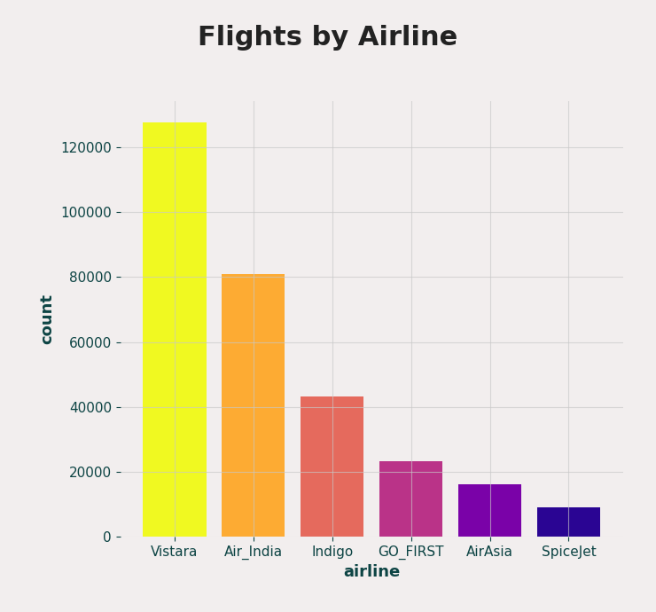
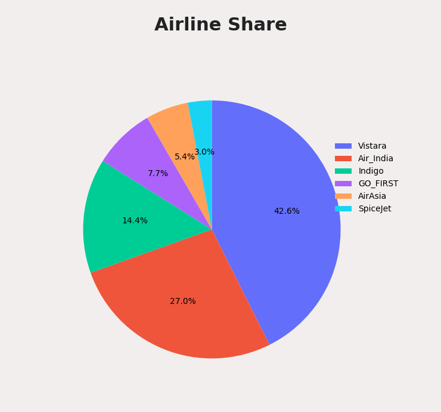
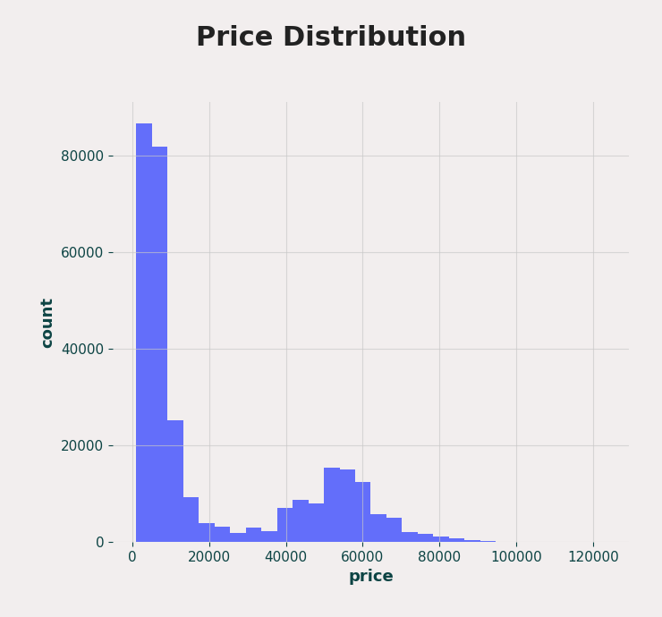
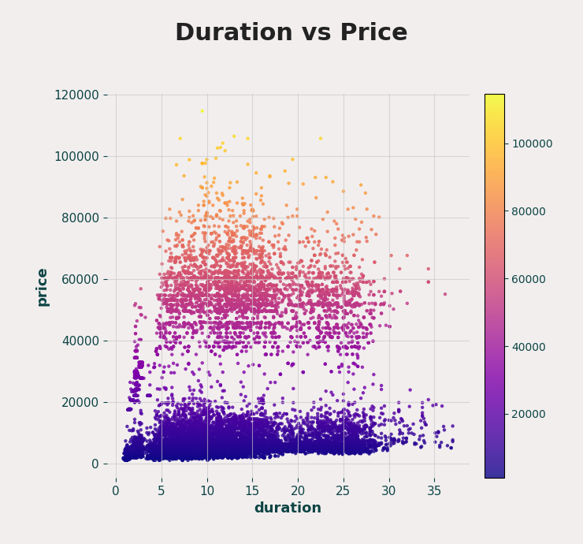
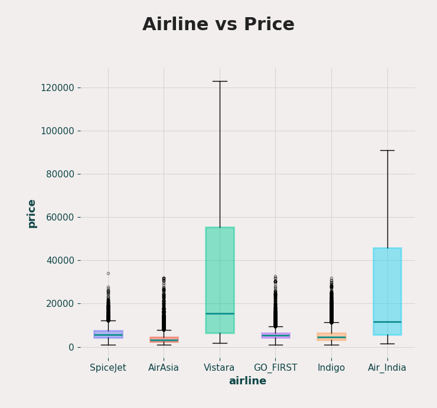
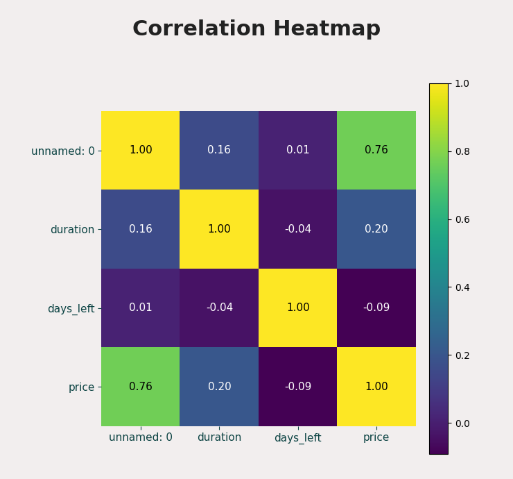
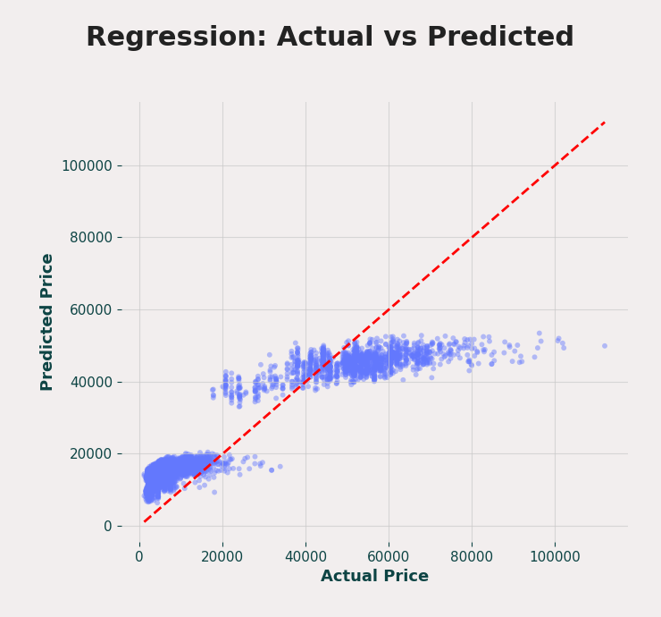
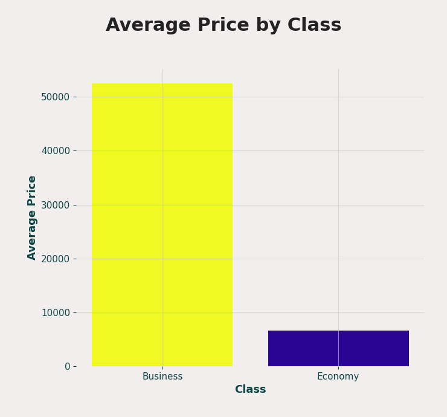
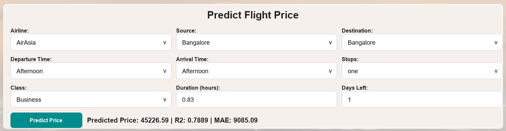

# Flight Price Analysis and Prediction Dashboard

This project is a Flask-based dashboard for analyzing airline ticket data and predicting flight prices. It combines interactive Plotly visualizations with a scikit-learn regression model so users can explore price trends and estimate fares from flight details.

## Screenshots

### Dashboard Overview



The overview section shows the airline logo selector, model evaluation metrics, total flight records, and unique flight counts for Business and Economy classes. It gives a quick summary of the dataset and the current prediction model performance.

### Analytics Charts

| Flights by Airline | Airline Share |
| --- | --- |
|  |  |

**Flights by Airline:** Shows how many flight records are available for each airline. This helps identify which airlines dominate the dataset.

**Airline Share:** Displays the same airline distribution as percentages. It makes it easier to compare each airline's overall share in the dataset.

| Price Distribution | Duration vs Price |
| --- | --- |
|  |  |

**Price Distribution:** Shows how ticket prices are spread across the dataset. Most tickets fall into lower price ranges, while higher-priced tickets appear less frequently.

**Duration vs Price:** Compares flight duration with ticket price. It helps reveal how price changes across short, medium, and long-duration flights.

| Airline vs Price | Correlation Heatmap |
| --- | --- |
|  |  |

**Airline vs Price:** Compares price ranges for each airline using box plots. This highlights median prices, spread, and possible outliers for different airlines.

**Correlation Heatmap:** Shows relationships between numeric columns such as duration, days left, and price. Stronger values indicate features that move more closely together.

| Regression: Actual vs Predicted | Average Price by Class |
| --- | --- |
|  |  |

**Regression: Actual vs Predicted:** Compares actual ticket prices with model-predicted prices. Points closer to the red diagonal line indicate better predictions.

**Average Price by Class:** Compares average ticket prices for Business and Economy classes. It clearly shows the price gap between the two travel classes.

### Price Prediction



The prediction form lets users choose airline, source, destination, timing, stops, class, duration, and days left before travel. After submission, it returns the predicted flight price along with model metrics.

## Key Features

- Flight count analysis by airline.
- Airline market-share visualization.
- Price distribution and duration-vs-price analysis.
- Airline-wise price comparison using box plots.
- Correlation heatmap for numeric features.
- Actual-vs-predicted regression performance chart.
- Average price comparison between Business and Economy classes.
- Flight price prediction form with model metrics.

## Model Summary

The application trains regression pipelines with preprocessing for numeric and categorical flight features. It uses:

- Numeric inputs: `duration`, `days_left`
- Categorical inputs: `airline`, `source_city`, `destination_city`, `departure_time`, `arrival_time`, `stops`, `class`
- Target output: `price`

The dashboard displays the current R2 score and mean absolute error after model evaluation.

## Tech Stack

- Python
- Flask
- Pandas
- NumPy
- Plotly
- scikit-learn

## Project Structure

```text
Fight-price-analysis-prediction-dashboard/
|-- app.py
|-- flight_price_prediction.csv
|-- README.md
|-- screenshots/
|-- static/
`-- templates/
```

## Run Locally

Install the required Python packages:

```bash
pip install flask pandas numpy plotly scikit-learn
```

Start the Flask app:

```bash
python app.py
```

Open the dashboard in your browser:

```text
http://127.0.0.1:5000/
```

## Prediction Endpoint

The app exposes a `POST /predict` endpoint. It accepts flight details as JSON and returns:

- Predicted flight price
- Model accuracy percentage
- R2 score
- Mean absolute error
